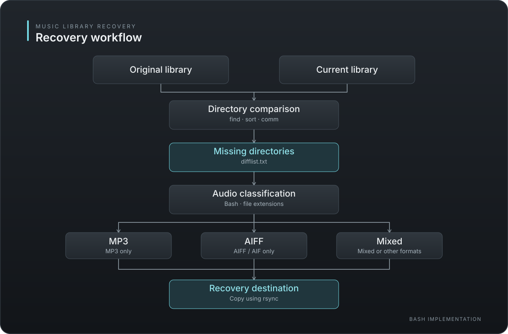

# Music Library Recovery

**Find what's missing. Recover what matters.**

A filesystem comparison and recovery utility designed to identify, classify and recover missing music library folders.

## Overview

Music Library Recovery originated from a real problem encountered during the migration of my personal music collection.

Some folders had not been transferred, and the size of the collection made manual comparison impractical. Rather than performing another full synchronisation, I needed a precise way to identify and recover only what was missing.

The result was a focused command-line workflow built using Bash and standard Unix filesystem utilities.

## The Solution

The recovery process consists of three main stages:

- **Detection** — Compare the directory structures of the original and current libraries to identify missing folders.
- **Classification** — Inspect the missing folders and categorise them according to their audio content.
- **Recovery** — Copy the identified folders to a designated recovery destination using `rsync`.

The original libraries are used as sources of information and content, rather than targets for deletion or synchronisation.

## Workflow

## Audio Classification

| Category | Description |
|---|---|
| MP3 | Folders containing exclusively MP3 audio |
| AIFF | Folders containing exclusively AIFF or AIF audio |
| MIXED | Combinations of formats or other audio formats |

The classification is based on file extensions. Non-audio files, such as artwork, documents and playlists, are intended to be excluded from the classification process.

## Technical Implementation

The current recovery implementation is available in [`missingfolders.sh`](missingfolders.sh).

The comparison stage generates a list of missing directories, stored in `difflist.txt`. The recovery script then processes that list, classifies the folders and copies their contents to the recovery destination.

### Technologies

| Technology | Purpose |
|---|---|
| Bash | Workflow automation and processing logic |
| find | Filesystem traversal |
| sort | Directory list ordering |
| comm | Directory list comparison |
| wc | File counting |
| mkdir | Destination directory creation |
| rsync | File and directory copying |
| Git & GitHub | Version control and project development |

## Usage

The current Bash implementation requires manual configuration.

1. Generate a list of missing directories by comparing the original and current library structures.
2. Configure the source, recovery destination and missing-directory list in `missingfolders.sh`.
3. Review the paths and directory list before executing the script.
4. Run the script using Bash.
5. Review the recovery summary and any reported errors.

Always test with a small, controlled dataset before processing an important music collection.

## Development Status

**Working Bash prototype — successfully tested on a real music collection.**

The project is currently evolving towards a cross-platform Python desktop application.

Planned development includes:

- Integrated directory comparison.
- Automated testing.
- Recovery preview and selection.
- A minimalist graphical interface.
- Cross-platform compatibility.

The original Bash implementation remains the functional foundation of the project.

## Supported Platforms

Music Library Recovery is being developed as a cross-platform desktop application for:

- macOS
- Linux
- Windows

The current Bash prototype has been successfully tested on macOS. The Python desktop implementation is under development, with full cross-platform compatibility as a core requirement.

## Project Philosophy

Music Library Recovery is built around a simple principle: solve a specific problem with precision, without introducing unnecessary complexity.

It is both a practical utility and an ongoing exploration of filesystem operations, automation and software engineering.
